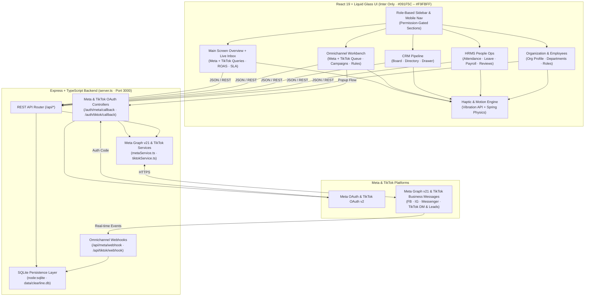
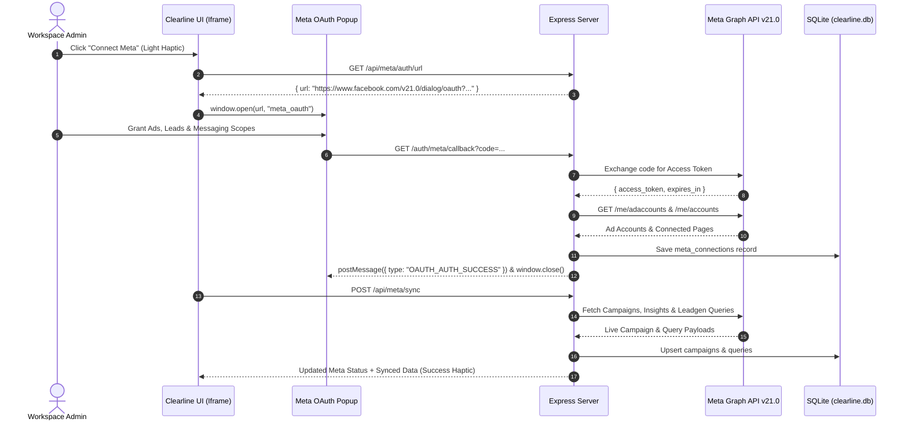
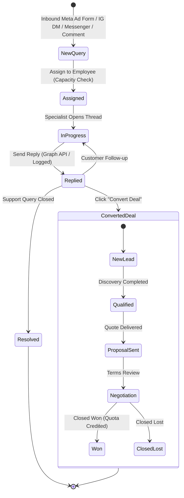
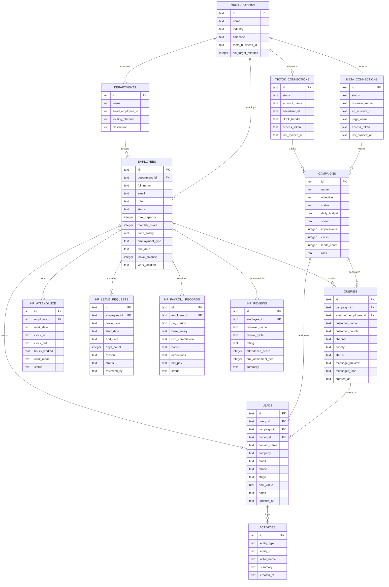
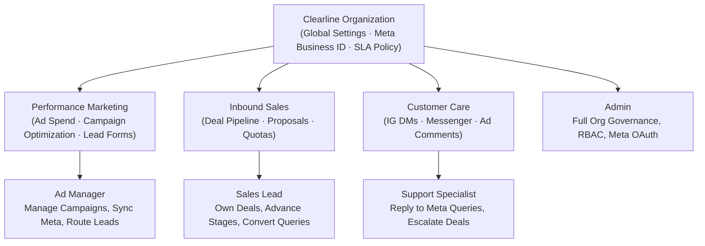

# Clearline CRM — System Architecture & Workflow Diagrams

All diagrams use standard Mermaid notation reflecting the exact implemented frontend, Express backend, Meta Graph API v21.0 integration, and SQLite schema.

---

## 1. Full-Stack System Architecture

---

## 2. Meta OAuth 2.0 & Real-Time Query Sync Sequence

---

## 3. Meta Query Triage & CRM Deal State Machine

---

## 4. Relational Database Schema (ER Diagram)

---

## 5. Organization, Department & RBAC Hierarchy

